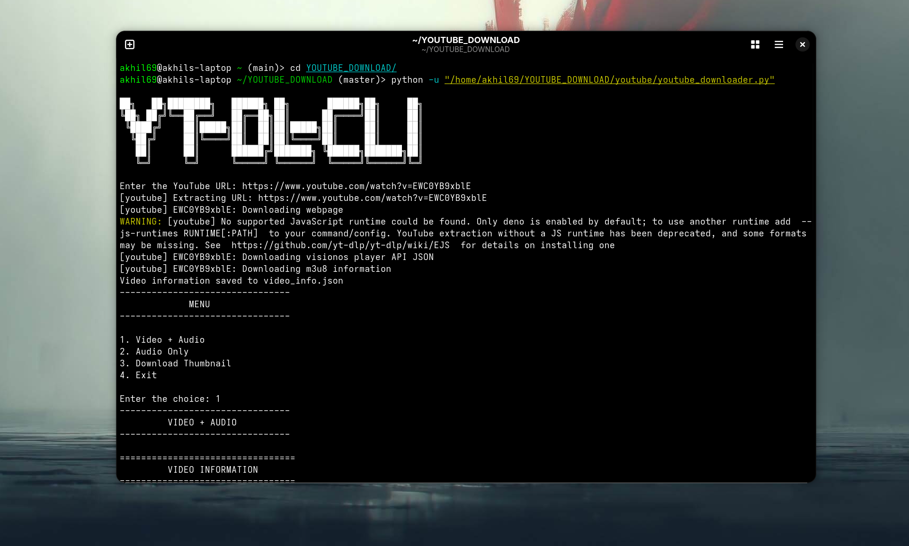

# YouTube Downloader

A Python-based YouTube Downloader built using `yt-dlp`.

This project allows users to download YouTube videos with both **video + audio** or download **audio only**. It also provides video and audio information before downloading and automatically downloads video thumbnails.

---

## Features

- Download YouTube videos with audio.
- Download audio only.
- Choose video quality:
  - 360p
  - 480p
  - 720p
  - 1080p
- Display video information before downloading.
- Display audio information before downloading.
- Automatically download and save video thumbnails.
- Organize downloaded files into separate folders.
- Save extracted YouTube metadata as JSON.
- Uses FFmpeg for audio extraction and video/audio merging.
- Built completely with Python.

---

## Technologies Used

- **Python**
- **yt-dlp**
- **FFmpeg**
- **JSON**
- **OS module**

---

## 📁 Project Structure

```text
YOUTUBE_DOWNLOAD/
│
├── README.md
├── requirements.txt
├── video_info.json
│
└── youtube/
    ├── audio/
    │   └── Downloaded audio files
    │
    ├── downloads/
    │   └── Downloaded video files
    │
    ├── thumbnail/
    │   └── Downloaded video thumbnails
    │
    └── youtube_downloader.py
```

---

##  Download Folder Setup

Before running the program, you need to provide your own download paths.

Open `youtube_downloader.py` and configure the folder paths for:

- Video downloads
- Audio downloads
- Thumbnail downloads

Make sure the paths point to valid directories on your system.

---

## Requirements

This project was developed and tested with the following environment:

| Software | Version |
|---|---|
| Python | 3.14.7 |
| yt-dlp | 2026.08.19 |
| FFmpeg | 8.1.2 |

### Python

Python **3.14.7** is recommended.

Check your Python version:

```bash
python3 --version
```

### yt-dlp

Install yt-dlp using:

```bash
pip install yt-dlp
```

### FFmpeg

FFmpeg is required for audio extraction and merging separate video and audio streams.

Check your FFmpeg installation:

```bash
ffmpeg -version
```

### Install Requirements

Install all Python dependencies using:

```bash
pip install -r requirements.txt
```

---

## How to Run

Navigate to the project directory and run:

```bash
python3 youtube/youtube_downloader.py
```

---
